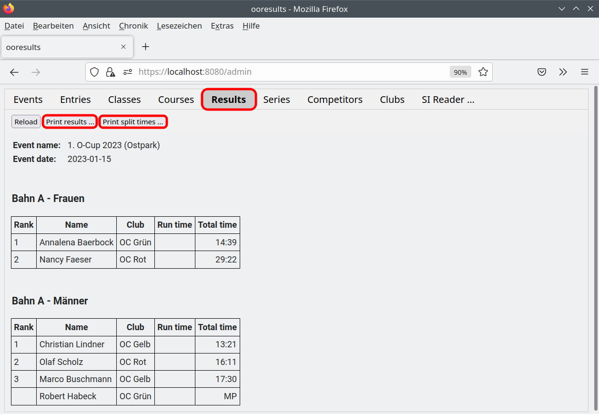
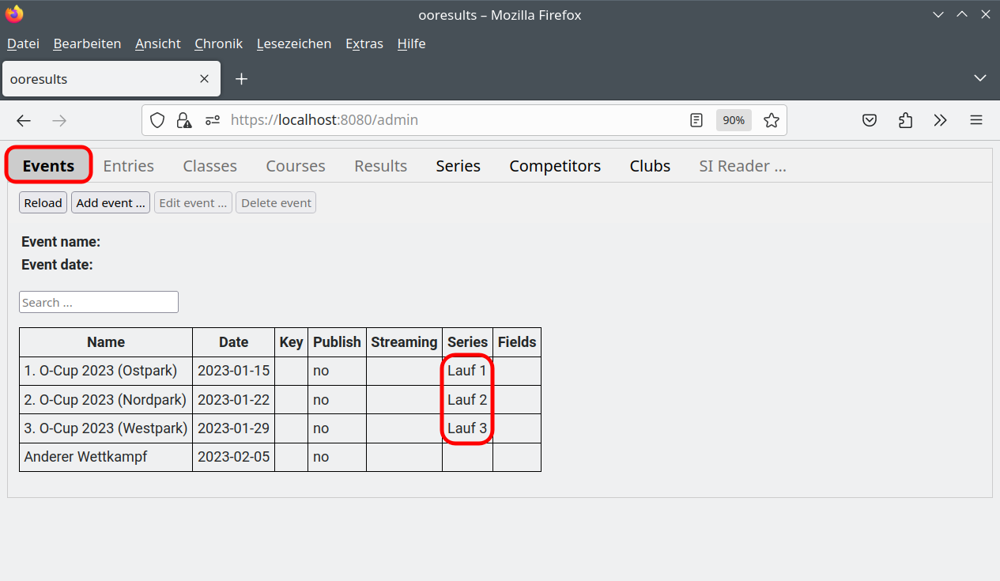
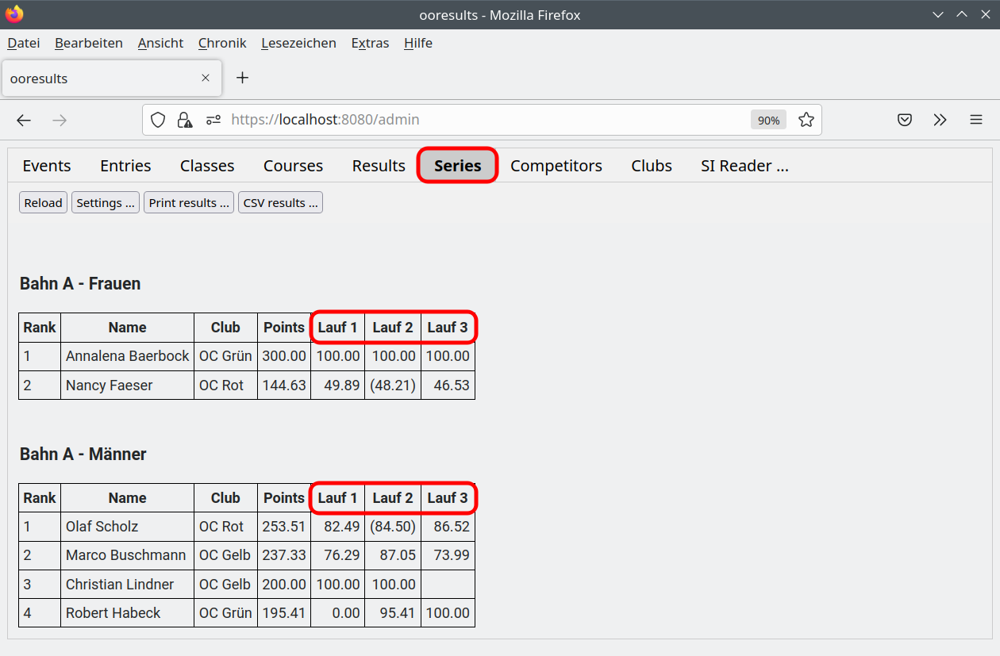
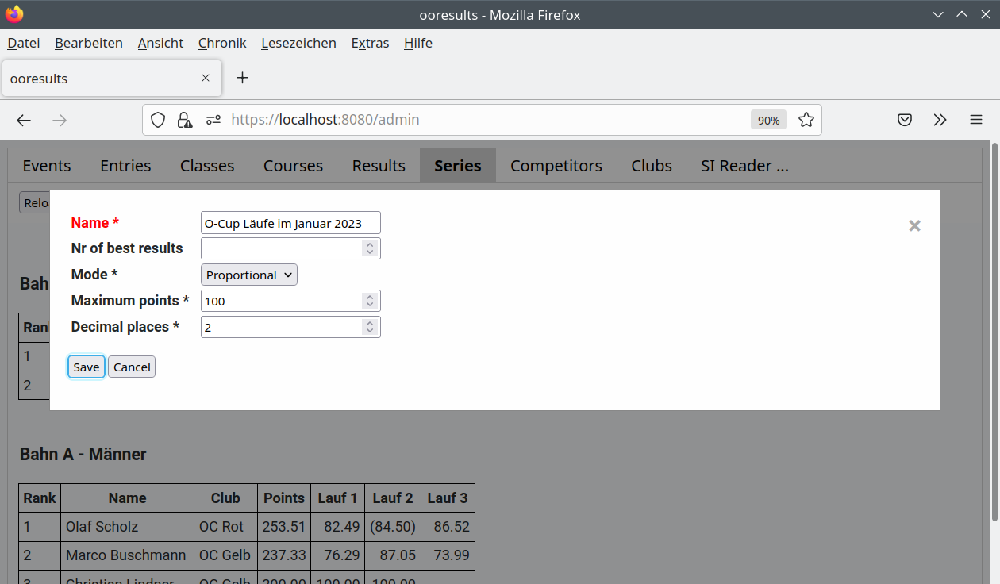
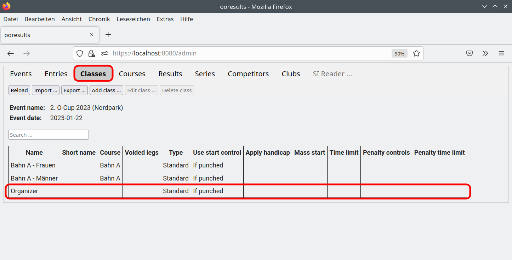
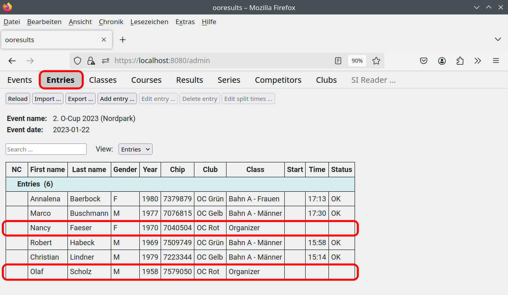

Tutorial - Teil 3
=================

.. only:: html

   .. contents::
      :depth: 2

Anzeige der Ergebnisse
----------------------

1. Anklicken des Registerblatts "Results"

Mit den Funktionen "Print results ..." bzw. "Print split times ... " können PDF-Dateien
mit den Ergebnissen bzw. Zwischenzeiten erstellt werden.

.. note::

   Ein Exportieren der Ergebnisse in verschiedene Formate (einschliesslich IOF XML 3.0 ResultList)
   ist über die Funktion "Export ..." im Registerblatt "Entries" möglich.

Berechnung und Anzeige des Gesamtergebnis
-----------------------------------------

Wettkämpfe mit einem Eintrag im Feld "Series" werden zu einem Gesamtergebnis zusammengefasst.
Das Gesamtergebnis wird im Registerblatt "Series" angezeigt, dabei werden die Wettkämpfe zeitlich sortiert,
und als Überschriften die im Feld "Series" angegebenen Texte verwendet.

.. note::

   Es lässt sich derzeit pro Datenbank nur ein Gesamtergebnis berechnen.
   
Die Berechnung des Gesamtergebnis wird im "Settings" Dialog festgelegt. Der "Settings" Dialog wird über
die Funktion "Settings ..." geöffnet.

.. seealso::

   Eine Beschreibung der Felder befindet sich im Kapitel :ref:`settings`.

Zusammenführen von Teilnehmern
------------------------------

Teilnehmer werden durch ihren Vor- und Zunamen identifiziert. Wurde z.B. "Annalena Baerbock"
in einem anderen Wettkampf der Serie als "Annalena Bärbock" hinzugefügt, werden die Ergebnisse
von "Annalena Baerbock" und "Annalena Bärbock" im Gesamtergebnis nicht zusammengefasst,
sondern als Ergebnisse zweier verschiedener Teilnehmer angezeigt.

Mit Hilfe der Funktion "Merge competitors ..." im Registerblatt "Competitors" können
unterschiedliche Schreibweisen einer Person bereinigt werden. Bei einem Zusammenführen 
der Läuferinnen "Annalena Bärbock" und "Annalena Baerbock" zu "Annalena Baerbock" wird
der Name "Annalena Bärbock" in allen Wettkämpfen durch "Annalena Baerbock" ersetzt
und anschliessend "Annalena Bärbock" aus der Competitors-Liste gelöscht.
   
.. warning::

   Haben "Annalena Bärbock" und "Annalena Baerbock" unterschiedliches Geschlecht oder Geburtsjahr,
   wird nicht nur in allen Wettkämpfen der Name, sondern auch Geschlecht und Geburtsjahr geändert.

Veranstalterbonus
-----------------

Teilnehmer, die in einem Wettkampf der Kategorie "Organizer" oder "Organizers" zugeordnet sind,
erhalten für diesen Wettkampf einen Veranstalterbonus. Er beträgt 50% des Punkte-Ergebnisses
bei Teilnahme an einem Lauf, ansonsten ist es der Durchschnitt der beiden besten Punkte-Ergebnisse.

.. warning::

   Die Kategorien "Organizer" und "Organizers" erscheinen nicht in Start- und Ergebnislisten
   und können daher nicht als Wettkampfkategorien verwendet werden.
